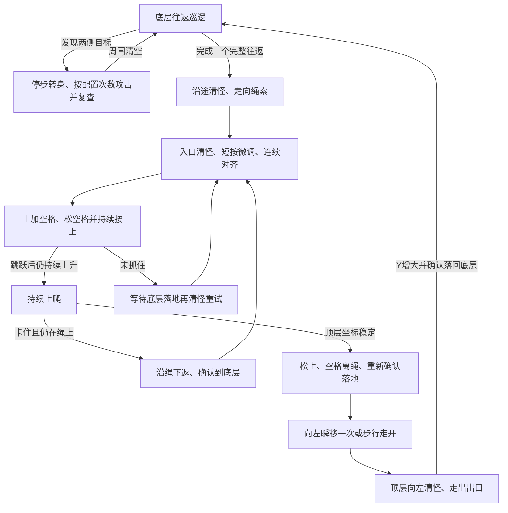

# mxd

冒险岛怀旧服「蓝色庭院2」蓝独角狮脚本。基于原先的 Windows / Python / MSS / pynput 方案，增加主画面识别、底层与顶层清怪，以及方向键加 F 瞬移。

Python 3.10–3.12，Windows 上运行游戏。Linux 可运行视觉、决策和按键模拟测试，不能直接操控 Windows 游戏。

## 简单定点：向右 D/A 攻击、定期左移补打并回位

使用独立入口 **`python -m lionbot.simple`** 和 `config.simple.local.json`。这个模式只截图小地图、读取黄点 X，不运行怪物、名牌、颜色或地形识别。普通攻击保持朝右，定期执行下面的左移流程；不爬绳、不跳跃、不瞬移。

默认动作：启动先按一次 Alt；**始终朝右攻击，累计按 D 6 次后，切换为 A 连打 4 次，再恢复 D**，一直重复。6 指实际发出的 D 按下次数，不是 6 组或 6 轮；通过 `d_shots_before_a` 修改。A 每组次数通过 `a_attack_shots` 修改。每 190 秒按一次 Alt。已移除宠物说话和中文聊天输入流程。

D 仍默认每组 3 次，每次间隔至少 0.9 秒；每组最后一次松开攻击键后等 3 秒，再进行下一组。默认就是两组 D（3＋3）后插入一组 A（4 次），然后继续 D。A 的单次间隔也使用 `attack_interval`，完成 4 次后使用同一组间等待 `group_pause`。若把 D 切换次数改成不能被组数整除的值，会保留未完成的 D 组，A 打完后继续。

X 偏离站位超过容差时，先就地**只朝右补打 3 次 D**，再保持方向键连续步行回到挂机 X。补打的 D 同样计入 6 次换键计数；若中途达到次数，会先完成 A 的 4 次，再继续补打 D。若最后一次补打恰好达到次数，则先回位，之后先打 A 再使用 D。A 不计作补打 D。接近一个小地图像素内或小幅越过目标时松键；若回位时向左走，会先重新面朝右再攻击。只按 X 回位，不判断平台高度。

暂停、失焦、黄点丢失、回位和 F9 重设挂机点，都保留 D/A 换键进度，不会漏掉尚未完成的 A。计数依据已发送的按键，不根据怪物血量或伤害反馈判定技能是否命中。

新增定期移动：**正常攻击和被击退补打的 D/A，合计达到随机 15～25 次 → 短按左方向键随机 5～15 次 → 朝左用 D 攻击 3 次 → 按黄点 X 连续步行回挂机点 → 重新朝右继续原 D/A 循环**。这里的 5～15 是方向键短按次数，不是角色宽度，无需新增距离校准。每次短按默认按住 0.04 秒、松开至少 0.06 秒，按下和松开分开发送；不保持左键走完整段。

每轮只抽取一次攻击阈值，到触发时再抽取一次短按次数，不逐帧改变目标。左移开始时会暂停普通回位流程，避免把主动左移误判成被击退；朝左的额外 3 次 D 不计入普通组、D/A 换键进度或下一轮累计次数。回到站位后将累计次数归零，再抽取下一轮 15～25 次。若在 A 组中途触发，回来继续打完原来剩余的 A；不会因此重开整组。

定期移动期间暂停/失焦/黄点丢失，都会松键并保留已短按和已补打的次数，恢复后继续。Alt 到期会等整次定期移动结束后再按。F9 重设站位时则取消旧移动流程，重新开始累计，但保留原 D/A 换键进度。

先停止原来的挂机程序，手动走到新的挂机位置，然后运行：

```powershell
.\.venv\Scripts\python.exe -m lionbot.simple --setup
```

按截图提示切回游戏。若同目录已有 `config.plants.local.json` 且窗口尺寸相同，会只复用小地图框；否则只框选一次小地图内部。自动读取**当前**黄点 X，重新保存为简单模式的站位；不需要点脚底或采集任何图片。

启动新模式：

```powershell
.\.venv\Scripts\python.exe -m lionbot.simple --run
```

运行中 **F8 暂停/恢复，F9 把当前黄点 X 保存为新的挂机点，F12 退出**。F9 可在暂停时使用，但游戏必须在前台；新站位重置普通 D 组数和定期移动计数，保留 D/A 换键进度和 Alt 定时。遇到正在施法时等本次施法完成再按 Alt；失焦或黄点丢失时松键等待。省略 `--run` 只观察 X，不发送按键、不累计攻击。

也可停止运行后，直接指定新的归一化 X，再启动：

```powershell
.\.venv\Scripts\python.exe -m lionbot.simple --set-x 0.6778
.\.venv\Scripts\python.exe -m lionbot.simple --run
```

变量在 `config.simple.local.json`，修改后重启生效；示例见 [`config.simple.example.json`](config.simple.example.json)。已有简单配置和挂机 X 可直接继续使用，无需重新 `--setup`；新增的定期移动参数缺省时自动使用下表默认值。旧的宠物说话参数 `pet_chat_min_seconds`、`pet_chat_max_seconds`、`pet_commands`，以及早期左右轮次参数会忽略，可自行删除。旧地图和食人花识别配置不受影响。

| 参数 | 默认值 | 含义 |
| --- | --- | --- |
| `station_x` | 采集值 | 挂机 X，可直接修改或运行中按 F9 重设 |
| `right_attack_shots` | `3` | 朝右每组 D 次数 |
| `d_shots_before_a` | `6` | 累计多少次 D 后切换为 A，包括回位前补打的 D |
| `a_attack_shots` | `4` | 每次切换后连续按 A 的次数，打完恢复 D |
| `attack_interval` | `0.9` | D/A 单次按下之间的最小秒数 |
| `group_pause` | `3.0` | 一组最后一次松开攻击键后，距下一组的等待秒数 |
| `recovery_shots` | `3` | 偏离站位后朝右 D 次数，不计入正常组数 |
| `alt_interval` | `190.0` | Alt 周期秒数，启动先按一次 |
| `x_tolerance` | `0.008` | 启动回位的 X 容差；实际至少为两个小地图像素，容纳转身位移和读点量化 |
| `move_attack_min` / `move_attack_max` | `15` / `25` | 每轮触发定期移动的 D＋A 总攻击次数，随机取含两端的整数 |
| `move_left_taps_min` / `move_left_taps_max` | `5` / `15` | 每轮短按左方向键次数，随机取含两端的整数 |
| `move_attack_shots` | `3` | 左移后朝左补打的 D 次数 |
| `move_tap_hold` / `move_tap_gap` | `0.04` / `0.06` | 每次左键短按的按住时间、松开后间隔，单位秒 |

该模式的 D/A 发送顺序、总攻击计数、随机边界、短按/松开次数、左侧攻击和回位后续打，通过模拟时钟、键盘和简化移动测试；当前云机器未运行 Windows 游戏，尚未验证实机伤害输出或定期移动是否能解除原地攻击限制。

## 散步路2：食人花单站位挂机

旧地图和爬绳流程保留，新增独立的 `stationary` 模式。手动选一个安全站位后，程序识别左右两侧射程和攻击高度内的食人花，先转身再按 D，每组 **3 次**、间隔至少 **0.9 秒**；受击短暂漏检会继续完成当前组。周围清理完保持原地等待刷新，不巡逻、不爬绳、不瞬移、不随机打空气。启动按一次 Alt，此后每 190 秒一次。

被击退后先等当前施法周期结束，**就地清理当前高度和射程内的左右食人花，复查清空后再回位**。回位途中又识别到目标会停步清理，避免顶着远程攻击一直往回走。射程外目标不追击。回位从头到尾保持方向键连续步行，不再反复短按；接近原站位约一个小地图像素就松键确认，不追逐亚像素位置。启动回位的容差仍至少为两个像素，容纳量化和转身的小位移。

`station_recover_timeout` 默认 6 秒，现在表示**连续没有向站位取得进展的时间**，不再限制整个回位过程只能持续 6 秒。每次向目标前进都会刷新计时，再次被击退后的新回程也正常计时；战斗与清场复查不计入。确实持续卡住才松键提示，可手动回位或 F8 暂停后恢复。主画面定位缺失时仍可按黄点回位，但不启动新的识别攻击。

右侧被打下一个台阶时，按已确认的路线自动返回：**Y 增大 → 等下层落地稳定 → 先清理下层可攻击目标 → 连续向左走 → 向左受阻约 0.4 秒时按左＋空格 → 保持左完成跳跃 → 重新确认原平台 Y → 清怪并回到攻击点**。不需要手填下层 X/Y，也不需要测量 F。空中不插入攻击，跳跃不连续乱按；失败后先等落地，再重试，默认最多三次。此流程仅对应当前地图确认过的“右侧单台阶、向左跳可回来”，不进行任意地图寻路。向左越过站位仍在下层、跳跃次数用尽或返回超时会松键提示。

旧的 `config.plants.local.json`、站位和食人花模板可直接保留，更新源码即可。新增默认值为 `station_step_recovery=true`、`station_step_max_attempts=3`、`station_step_timeout=15`；下层战斗会顺延台阶返回计时。若不需要自动上台阶，可将 `station_step_recovery` 改为 `false`，平台变化时只松键提示。

**坐标由程序读取，站位由你选择；图片由程序截图，怪物由你框选。** 不用手填地图边界、梯子或站位 X/Y，也不能仅凭地图名自动决定哪里站着安全。新地图使用独立的 `config.plants.local.json` 和 `calibration/plants-*` 目录，不覆盖 `config.local.json`、原模板或旧地图的六次攻击配置。

更新源码后，先进入散步路2，按下面命令采集：

```powershell
.\.venv\Scripts\python.exe -m lionbot --calibrate-stationary
```

按界面顺序完成：

1. 框选当前小地图的地图内部，排除标题、按钮和黄色图标；再框选主画面。程序截图并读取黄点 X/Y，不需要沿用蓝色庭院2的旧坐标。
2. 框选角色名牌文字并点击自己的脚底，保存可选的角色定位样本。
3. 框选一只清晰食人花的完整花头或身体，再点击**这只食人花的根部接地点**。建议保存正常、张嘴攻击两三张姿态；排除技能光效、伤害数字和大块背景。完整花头的颜色和轮廓比小眼睛更适合作模板，不要求必须截全身。每张单独保存，可中断续做；采完在菜单点 Next 或按 Enter。
4. 按提示在**同一平台**手动走一小段，程序测量黄点与主画面的比例；前后各点一次自己的脚底，并框选固定地形用于镜头补偿。首次需要做这一次，不能直接套旧地图的归一化射程。
5. 手动回到最终挂机站位，松开方向键。程序重新截图、自动记录当前 X/Y；在这张冻结截图依次点自己的脚底和头顶，保存站位参考与攻击高度。若被远程攻击击退导致采集不稳定，先清理周围，再用 `--record-station` 重试；已采模板保留。

射程优先沿用**同尺寸游戏窗口**下旧配置中火焰箭的主画面像素距离；不复制旧地图的 X/Y。如果没有旧射程资料，会提示你在冻结截图点选**已经手动用 D 验证能命中的同层最远位置**，保存为 `attack_range_px`。这是一次人工确认，程序不会声称自动测出技能命中距离。无需测量 F。框选均在程序截图中进行，不用把截图拉到与游戏窗口一样大。

采集完成后启动：

```powershell
.\.venv\Scripts\python.exe -m lionbot --config config.plants.local.json --run --show
```

想换站位时，只更新站位和脚底参考，不重采食人花：

```powershell
.\.venv\Scripts\python.exe -m lionbot --record-station
```

也可加 `--config` 指定另一份定点配置。若要重测射程，将该配置的 `attack_range_px` 设为 `null` 后再执行 `--record-station`；同尺寸旧射程仍可自动导入，改用不同技能时请直接把此字段改为新技能的实测像素距离。F8 暂停/恢复，F12 退出。原地图仍用原命令 `python -m lionbot --run`。

### 局部识别与降低 CPU 占用

已有食人花配置、图片和站位可直接保留。食人花模式先确定当前脚底，再只在**左右各 `attack_range_px`、脚底到头顶 `player_height_px`** 的附近搜索怪物。搜索框为完整花头模板留少量边缘，候选仍须通过原射程/攻击高度筛选；远处和完全高于攻击带的平台怪不参与识别攻击。预览青色 `LOCAL SEARCH` 框是实际模板搜索范围，紫色框是攻击带；整个游戏窗口仍需截图，以读取黄点和必要时重新定位地形。

默认 `stationary_fps=10`，实时模式使用一个 OpenCV 工作线程。角色名牌优先在上次位置附近查找，地形参考不再逐帧重建；需要地形定位时，食人花模式先缩小图像再取特征，换算后仍使用原图像素，不改变已校准的射程和脚底。若仍希望降低占用，可以在 `config.plants.local.json` 添加 `"stationary_fps": 8`，支持 5～20；不带 `--show` 可以省去预览绘制。

模板本来就自动生成左右镜像；若朝左仍漏检，可能是背景、嘴部开合或受击动画与样本不同。现在默认开启 `plant_color_fallback=true`：根据已有样本学习**棕色花头轮廓、尺寸和根部偏移**，结合周围绿叶补识别，默认连续 `plant_color_frames=3` 帧出现才确认攻击（且不少于模板确认帧数）。预览标记 `COLOR PENDING` / `COLOR READY`，确认后沿用每组三次、先清两侧再回位的逻辑。单纯绿色区域不会强制攻击；相邻绿叶、树干、地砖仍可能造成颜色混淆，若实机出现误认，可设 `"plant_color_fallback": false` 保留模板识别。

无需只截眼睛或必须重采全身。建议模板包含完整棕色花头和紧邻叶片，尽量少带蓝天、地砖、特效和宠物，点击同一只怪的根部接地点；可以保存左右和张嘴姿态。若样本没有可用棕色花头，启动会提示并继续使用模板识别。局部搜索能降低计算量、排除无关画面；实际识别率仍取决于样本和画面，不能保证所有朝向都命中。

## 已实现的行为

| 项目 | 当前逻辑 |
| --- | --- |
| 火焰箭 | D 短按，实际按下时间之间至少 0.9 秒；最后一次施法也等完整周期才移动 |
| 导航定位 | 小地图黄点决定移动、掉头、往返计数和爬梯；主画面名牌缺失不会停止导航 |
| 目标选择 | 主画面匹配蓝独角狮多姿态模板，两帧确认；两侧在射程和攻击高度内都清理；首组优先近处，组内锁定方向，完成后两侧按组轮换 |
| 主画面位置 | 一次点击脚底建立黄点与地形参考，之后补偿镜头滚动；旧名牌可作辅助，不要求持续命中 |
| 宠物区分 | 不把小地图当成怪物雷达；宠物通过主画面的外形、颜色模板排除，需要现场观察验证 |
| 射程 | 使用配置中的归一化距离换算为主画面像素；最初坐标为 0.086，当前实测预设换算后为 0.1305 |
| 攻击高度 | 角色脚底到头顶为攻击带，默认身高 64px；用怪物识别框到标定脚底的纵向范围判断相交，允许攻击够得着的矮台阶怪 |
| 攻击次数 | 每组次数由 `attack_burst_shots` 设置，默认三次、间隔至少 0.9 秒；周围仍有正常确认目标就继续开组，两侧都有目标时按组轮换 |
| 清怪完成 | 连续至少三帧、持续至少 0.8 秒没有身边可攻击候选，才恢复原路线；受击漏检、待确认候选和定位丢失不算清空 |
| 随机攻击 | 实际步行后，每隔随机 6～12 秒可停步朝行进方向施法 1～2 次；与识别攻击共用施法间隔，不叠加按键 |
| 巡逻 | 先走到左侧内缩点，再向右到内缩点、返回左侧；每帧检测，无目标时连续走路；发现周围怪物先停步清理，清完继续原方向，清怪转身不改变往返计数 |
| 瞬移 | 巡逻至少间隔 12 秒、已步行足够距离、画面无候选且近期未战斗才偶尔方向＋F；旧配置的短冷却也受此限制；顶层离梯后保留一次左瞬移 |
| Alt | 挂机启动、有效定位后先按一次；从实际按下时间起每隔 190 秒按一次，暂停恢复不重复首按；施法、失焦、暂停和换层时顺延 |
| 往返计数 | 左内缩点→右内缩点→左内缩点算一次；完成三个完整往返后去梯子，不等待空场，遇怪不清零 |
| 上楼 | 满三轮后沿途清理周围并步行到入口 → 入口清怪 → 短按微调 → X 连续三帧对齐 → 上＋空格并持续保持上 → 验证上升 → 到顶后松上、空格离绳 → 重新确认落地 → 左瞬移一次或向左走开 |
| 下楼 | 顶层一路向左清怪，到出口继续沿途攻击、走落；确认落回底层后重新开始三轮巡逻 |
| 暂停退出 | F8 暂停/恢复，F12 退出，Ctrl+C 退出；失焦、黄点丢失、异常时松开脚本按住的键 |

基础默认值沿用最初测量：底层 X=0.029～0.659、Y=0.759；顶层 X=0.045～0.212、Y=0.130。**它们不是任意小地图框选范围的通用坐标。** 对已确认的 ROI `(24,73,137,103)`，使用下文实测预设；其他范围通过地图点位校准记录。巡逻在边缘内缩处掉头，利用射程覆盖边缘；主动下楼时才靠近顶层左出口。起点在地图中间时先向左到内缩点，这一小段不算一个往返；暂停保留已完成的往返，但不会补算中断的半程。

## 打怪和爬绳的阶段控制

参考 [Aynamuk/MapleStoryAutoLevelUp-CN](https://github.com/Aynamuk/MapleStoryAutoLevelUp-CN/tree/94b1d9e44f885b311301c73a46df43a8cff035ec) 的 `HuntingState.on_frame`、`update_cmd_by_mob_detection` 和 `update_cmd_by_route`，采用统一动作优先级、转身后松方向再施法、跳跃抓绳时持续按上这三项做法。结合本地图的固定路线重新实现，保留现有黄点导航、头像模板、攻击高度和 JSON 配置；只处理打怪、步行、爬绳和上下楼循环。



每帧只执行当前阶段的一种动作。地面清怪优先于继续走路；爬绳、离绳和下落阶段优先于攻击、随机瞬移和 Alt。定时 Alt 顺延到落地，仍按实际按下时间计算下一个 190 秒。绳上不运行怪物模板匹配，只处理黄点和地形跟踪；落地后重新两帧确认目标。没有瞬移校准时也能完整上下楼，使用步行。

F8 暂停、失焦或黄点丢失后立即松键。恢复时先重新确认位置：绳上保持上键重验上升，底层重新清怪和对齐，顶层重新确认落地；不会直接沿用暂停前的上升次数或超时。日志 `phase=` 会显示「巡逻、清怪、前往绳索、入口清怪、入口微调、抓绳验证、上爬、沿绳下返、离绳落地、顶层落地、前往下落点、下落」。

更新时保留 `config.local.json`、`calibration/`、`.venv/`。`"attack_burst_shots": 6` 可继续使用，攻击间隔保持至少 0.9 秒；不用重采角色、怪物、地图或身高。按原命令启动：

```powershell
.\.venv\Scripts\python.exe -m lionbot --run --show
```

## 从名牌定位旧版更新

保留 `config.local.json`、`calibration/` 和 `.venv/`，覆盖源码。无需重采怪物或重新测地图坐标。旧版保存的两次攻击配置会在读取时升级为三次，其他自定义攻击次数（例如 6）保持原值；默认三个完整往返。

小地图黄点足以导航，但不能单独说明角色在滚动主画面上的像素位置。为了准确判断怪物在角色哪一侧、是否与攻击高度相交，先新增一次脚底参考：

```powershell
.\.venv\Scripts\python.exe -m lionbot --calibrate-anchor
.\.venv\Scripts\python.exe -m lionbot --run
```

第一条命令中，让角色站在底层地面，按提示截图，在冻结截图中**左键单击自己脚底与地面接触的位置**即可；不框名牌，不框怪物，不需要走动。会保存一张地形参考截图和黄点/脚底坐标到 `calibration/screen-anchor*`，不修改已有配置、模板或地图点位。之后启动挂机无需再点脚底。

运行时用固定地形匹配镜头位移，结合黄点位移换算主画面脚底，不拿屏幕中心猜角色位置。主画面跟踪短暂失败时，当前已确认的一组攻击可以完成；清怪复查最多等待 `combat_localization_grace`（默认 1.2 秒），仍无法定位时恢复原路线重新识别，并明确提示未确认清场。**爬绳入口必须有有效画面完成清怪确认，不能把定位丢失当成入口已清空。** 已开始爬绳后仍按黄点 X/Y 控制，无需名牌。缺少参考时会提示 `--calibrate-anchor`。窗口尺寸、DPI、小地图 ROI 或比例改变后，需要重做相应校准和脚底参考。若启动前手动移到没有重叠地形的区域，重新点一次脚底可建立新参考。

## 周围清怪与爬绳确认

战斗朝向与巡逻方向分开保存。例如正在向右巡逻，左侧出现怪物时会停步向左清理；清理后继续向右。首次选择近处目标，距离相同时优先保持当前朝向。转身按键默认持续 `face_hold=0.08` 秒，松开后再出招，组内不因两侧目标距离抖动反复改向。每组按 `attack_burst_shots` 指定的次数施法，默认三次，可设为六次。完成一组不代表已经击杀，仍识别到目标就继续；两侧都有目标时按组轮换清理。随机攻击途中识别到目标会转入目标清理。受击恢复匹配和未完成两帧确认的候选也会阻止过早恢复走路。超出射程或完全不与角色攻击带相交的目标不阻止继续寻路。

清场默认要求至少三帧且持续 0.8 秒没有可攻击候选；中途重新出现候选会重新计时，失焦、黄点丢失或画面定位丢失不会补算空场证据。清怪期间不累计往返；恢复行走后沿原路线完成三个完整往返，再去爬绳入口。

到入口附近先清理左右目标并复查空场，然后用 0.02 秒方向键短按微调 X。实际容差取 `ladder_tolerance` 与约半个小地图像素对应距离中的较小者，让角色靠近绳子中心，避免停在旧范围边缘反复抓空。进入范围后先松方向，连续三帧稳定才发送上＋空格。微调途中重新出现怪物，会返回入口清怪阶段，清完再次对齐。

抓绳时按住上再短按空格，随后只松空格，上键连续保持到验证和上爬阶段。等待初始跳跃阶段过去，再要求多个向上变化的 Y 观测、足够的净上升量，并保持在绳索 X 附近，才进入持续爬绳状态。高帧率下的小位移也会累计。单次上跳或静止不会被当成成功。未确认抓住时松键，等底层落地稳定后重新清怪、对齐、抓绳；默认最多尝试三次。已抓绳但上爬卡住或超时，会先按下沿绳回到底层，走完绳尾后再重试。下返也卡住、尝试用尽、微调反复超时或无法确认落地，才停止本次自动换层并打印原因，不在空中盲目左右微调。

到顶层后先连续确认 Y，松上、空格离绳；跳跃结束后再用新的三帧确认顶层落地，不能使用离绳前的旧坐标。左瞬移只执行一次；未测量、落点不合适、瞬移被停用或没有移开时，向左走离绳索继续清怪。到左出口后持续走出边缘，看到 Y 增大才松方向，确认落回底层后重启三轮巡逻。

旧配置自动使用这些新增默认值，已有地图、模板、身高和地形参考可直接保留。按实机需要可调：`clear_seconds` / `clear_frames`（清场复查）、`ladder_nudge_seconds`（微调时长）、`ladder_align_frames`（对齐确认帧数）、`ladder_max_attempts`（抓绳尝试次数）、`grab_confirm_seconds` / `grab_timeout`（抓绳验证时间）。净上升至少为 `grab_min_rise`（默认 0.02）和小地图两像素对应归一化距离中的较大者。

## 头像模板与角色攻击高度

**已有头像模板可以继续使用，不要求改采全身。** 建议完整头部包含双眼和蓝白轮廓，不只截小眼睛。采样后的脚底点击必须落在**同一只怪物真实脚底接地处**，不是头像框底边；脚底可以在模板框外。程序保存这个偏移，识别到头像后即可估算它到脚底的身体纵向范围。全身模板也支持，但仍要正确标定脚底。

只用眼睛的像素区域小，容易与宠物眼睛、背景亮点或特效混淆，也更受一两个像素偏移影响。当前继续以完整头部的灰度、对应位置颜色、边缘共同核对，眼睛保留在头像中；优先补充正常、行走和受击姿态。无需因为本次逻辑更新重新截取眼睛或全身。当前没有实机数据证明“只眼睛”能提高准确率。

旧版用角色脚底上下各 22px 比较怪物脚底，会排除一些实际可命中的矮台阶怪。新版只向上画攻击带：`[角色脚底 Y - player_height_px, 角色脚底 Y]`；怪物身体纵向范围与攻击带相交即通过高度检查，即使头像在角色头顶上方也可通过。完全位于攻击带上方或下方的怪物仍被排除。这个范围是几何筛选，不能代替实机命中验证。

已有配置没有身高字段时自动使用 64px，不需要重采怪物、地图或地形参考。要精确对应当前角色身高，可单独执行：

```powershell
.\.venv\Scripts\python.exe -m lionbot --calibrate-height
.\.venv\Scripts\python.exe -m lionbot --run --show
```

站在地面、完整露出角色；在同一张冻结截图中，先左键点自己的脚底，再点头顶（含帽子，不含技能特效、武器或名牌）。命令只更新 `player_height_px` 并备份旧配置，保留所有模板和坐标；不需要走动。也可手动设置该字段为实际主画面像素身高。旧的 `feet_tolerance_px` 保留读取兼容，不再控制攻击带。

旧版标成 `BEHIND` 的目标现在也参与周围清理；新版预览不再按身后过滤。`PENDING` 是等待确认；`HEIGHT` 才是高度不符。

**本版不处理中间台阶**，包括 X=0.337 / 0.346 / 0.365 的上移路线。非换层过程中，在中层或未确认落地时停止巡逻。若地面路线被台阶阻断，卡住后掉头，本段不计完整往返。抓绳失败或上爬卡住按上述流程回到底层重试，不会假定已经爬到顶层。

## Windows 安装和首次校准

在项目根目录的 PowerShell 中执行：

```powershell
py -3.12 -m venv .venv
.\.venv\Scripts\python.exe -m pip install -r requirements.txt
.\.venv\Scripts\python.exe -m lionbot --calibrate
.\.venv\Scripts\python.exe -m lionbot --calibrate-map
.\.venv\Scripts\python.exe -m lionbot --measure-teleport
```

校准会生成 `config.local.json` 和 `calibration/` 下的本机图像，不修改原来的三个脚本。每完成一项区域、角色定位或怪物采样就保存进度，配置和清单以完整文件替换，避免中断留下半个 JSON。已有配置先备份，再保存；备份和校准文件均被 Git 忽略。

`--calibrate` 引导完成：

1. 框选**小地图坐标区域**，排除标题和按钮。坐标以这个裁剪区域归一化；范围不同，地图点位和距离单位也不同。模板采集后用 `--calibrate-map` 记录当前范围内的地图点位，或在符合指定 ROI 时应用下文实测预设。
2. 框选主画面游戏区域，排除聊天栏和 HP/MP 栏。
3. 框选自己固定的角色名牌，点击自己脚底。该模板在新版只作可选辅助，命中时可建立地形参考，丢失时不影响黄点导航。首次模板流程仍保留此步骤；已有模板的用户可直接用上文 `--calibrate-anchor` 代替重采名牌。
4. 框选蓝独角狮的完整头部或身体，再点**同一只怪物的脚底落地位置**。每采完一只，会弹出按钮菜单：**Enter/Q=完成采样进入下一步，N=新截图，S=同图继续**。直接点击按钮也可以，不需要切回终端输入字母。头部模板也需要落地偏移；建议采集站立、行走、受击至少三种姿态，左右朝向自动镜像，不要截宠物、血条、伤害数字或其他怪物。
5. 在同一平地采集移动前后两个截图，点击角色脚底，并框选有固定地形的背景区域。程序结合小地图位移、角色屏幕位移与背景滚动，估算主画面/归一化 X 比例，并打印 0.086 射程对应的像素。背景配准不可靠时拒绝保存比例。

准备截图时，在弹出的菜单中按 Enter 或点击按钮，然后有 3 秒切回游戏并松开按键。选框后 Enter 确认；点脚底时左键单击。菜单里 Esc 或关闭窗口会暂停校准，已完成的数据保留。采样图像均在本机生成。若只需重测比例：

```powershell
.\.venv\Scripts\python.exe -m lionbot --measure-scale
```

若采样中断，再次运行 `--calibrate` 会自动跳过已完成的区域和角色采样，读取已保存的怪物清单。在采样菜单中按 Enter/Q 即可继续射程比例测量。若仅缺射程比例，`--measure-teleport` 会明确提示先运行 `--measure-scale`。

**从旧版恢复：** 更新时覆盖源码，保留原来的 `calibration/`、`config.local.json` 和 `.venv/`。旧版可能只保存 PNG，未保存区域和脚底偏移；这些数据不能从图片文件名推算。新版首次 `--calibrate` 会查找 `calibration/` 下最近的旧 `player.png` / `lion-*.png`，弹窗选择 Reuse，重新框选缺少的小地图和主画面范围，并在新截图中补点脚底。能够匹配当前截图的旧图片会复用，不会改写原图；暂未匹配到的姿态会保留，之后可补采。

若旧采样目录未自动选中，可指定它：

```powershell
.\.venv\Scripts\python.exe -m lionbot --calibrate --reuse-templates "calibration\旧文件夹名"
```

需要全新校准时运行 `--calibrate --restart-calibration`；旧图和配置备份仍保留。

`--measure-teleport` 在底层无遮挡平地手动测量三次「方向键＋F」的位移，记录带安全余量的上限。每次测量打印起点、终点 X/Y 和位移；起点必须先通过底层坐标校验，避免移动后才发现坐标不符。步行比例测量也打印前后 X/Y。未测量时不会自动猜测瞬移距离，全程步行也能完成自动上下楼。运行中若位移超过上限，会停用 F，改为步行。

如果角色明明在底层，却提示“在底层测量”，先查看实际坐标：

```powershell
.\.venv\Scripts\python.exe -m lionbot --check-position
```

该命令只要求已有小地图框选数据，尚未完成怪物采样或射程测量也能运行。它实时显示 X/Y、所判楼层和配置中的底层 Y，并在放大的小地图上用红圈标出实际识别的黄点。把预览放在游戏旁边，避免遮挡原小地图；Q/Esc 关闭。该模式不发送按键、不修改配置。

原始默认值要求底层 `Y=0.759 ± 0.035`。超出配置范围时，错误会列出实测 Y、允许范围和裁剪区域。先确认红圈标中本人；若识别正确而底层稳定读为其他 Y，应校准地图点位。**裁剪范围改变会同时改变 X/Y，不能仅改底层 Y 就继续沿用原边界、梯子和出口坐标。**

## 应用本次已确认的地图坐标

本次用户实测确认：小地图 ROI 为 `(24,73,137,103)`，底层 Y≈0.8107、顶层 Y=0.4806，底层左右端 X=0.0182 / 0.9745。无需再采集角色和怪物图片，也无需再手动点选已确认的边界，直接执行：

```powershell
.\.venv\Scripts\python.exe -m lionbot --apply-map-profile
.\.venv\Scripts\python.exe -m lionbot --measure-teleport
```

第一条命令会检查 ROI 一致、备份配置，并按同一地图的边界进行线性坐标换算。不是上述 ROI 时会拒绝应用。

| 参数 | 原坐标 | 当前 ROI 坐标 |
| --- | --- | --- |
| 底层 Y | 0.759 | 0.8107（实测） |
| 顶层 Y | 0.130 | 0.4806（实测） |
| 底层左/右端 X | 0.029 / 0.659 | 0.0182 / 0.9745（实测） |
| 梯子 X / 顶层右端 X | 0.212 | 约 0.2960（换算，与日志 0.2956 接近） |
| 顶层左侧走落点 X | 0.045 | 约 0.0425（换算） |
| 火焰箭最大归一化距离 | 0.086 | 约 0.1305（同一物理距离的单位换算） |

掉头内缩、边界余量、梯子容差和定点扫描间距也按 X 单位换算，楼层容差按 Y 单位换算。**已在当前 ROI 下测出的主画面像素比例、瞬移位移不再缩放**；角色、怪物模板和攻击高度阈值保持原值。命令可重复运行，不会叠乘坐标。梯子、出口的换算落点仍需在游戏中观察核对。

## 使用其他框选范围时校准地图点位

```powershell
# 只记录底层，关闭自动换层，便于先跑通底层。
.\.venv\Scripts\python.exe -m lionbot --calibrate-map --bottom-only

# 记录底层和顶层；完整成功后启用自动换层。
.\.venv\Scripts\python.exe -m lionbot --calibrate-map
```

先让角色在底层平地站稳，程序连续读取五帧，记录实际底层 Y。随后在放大的小地图内依次单击底层左端、右端和梯子中心，自动换算 X，无需重采模板。底层立即保存；如果后续暂停，底层结果仍保留，自动换层关闭。

完整校准还需手动爬到最上层，跳离梯子并站稳，再开始第二次截图；程序记录顶层 Y，再点选左侧走落点和右侧安全边界。顶层右端不得超过梯子 X。采样时 Y 持续变化会被拒绝，避免把爬梯中途记作平台。该命令不推断技能射程，`attack_range` 需与当前坐标单位一致；同一 ROI 下已完成的像素比例和瞬移测量可保留。

改变分辨率、DPI 缩放、角色名牌或小地图大小后重新校准。窗口可以移动，但不能被其他窗口遮挡或最小化。游戏若屏蔽 pynput 合成输入，本版不能保证按键生效；须先用底层模式现场核对。

## 先观察，再启用按键

```powershell
# 仅显示候选框和建议动作，不发送任何按键。
.\.venv\Scripts\python.exe -m lionbot --observe --show

# 先单独验证底层，禁用自动换层；无瞬移校准也可步行运行。
.\.venv\Scripts\python.exe -m lionbot --floor bottom --run

# 手动站上顶层后，可单独验证顶层，不自动上下楼。
.\.venv\Scripts\python.exe -m lionbot --floor top --run

# 完成校准后，运行底层优先的完整路线。
.\.venv\Scripts\python.exe -m lionbot --run
```

观察窗口默认缩小显示，可拖动调整，放在游戏旁边，不能遮住游戏；点击观察窗口会使游戏失焦，点回游戏即可恢复。即使游戏失焦或暂停，预览也支持 Q/Esc/关闭退出。绿色 `READY` 表示两侧已确认且通过高度、距离筛选；灰色 `HEIGHT` 表示高度不符，蓝色 `RANGE` 表示太远，橙色 `PENDING` 表示尚待确认。`~` 表示局部受击追踪。`dX`/`dYf` 为主画面像素距离，`dYf` 指怪物脚底相对角色脚底的高度差，不是头像中心。怪物竖线连到估算身体下端，实心点为标定脚底。紫色矩形从角色头顶到脚底，中央箭头表示原巡逻方向；当前战斗朝向看日志 `face`。

识别与决策使用同一个高度/距离筛选函数，两侧都参与清理。日志 `ready` 是周围可攻击数量，`height` 是高度不符数量，`recovered` 是受击追踪数量，`laps=已完成/要求` 是底层完整往返数。`move` 为巡逻方向，`face` 为战斗朝向，`clear=1` 表示正在清怪或复查，`phase` 显示中文阶段，`route` 显示对应内部状态，`grabs` 为本轮已执行抓绳次数。`screen=terrain` 表示地形参考定位，`nameplate` 表示名牌辅助，`unmapped` 表示暂无可靠主画面位置。换层期间 `mobs=0` 表示主动跳过怪物匹配，不作为清场证据。

可在 `config.local.json` 调整 `patrol_round_trips`（默认 3）、`attack_burst_shots`（默认 3）、`random_attack_min_seconds` / `random_attack_max_seconds`（默认 6 / 12）、`random_attack_max_shots`（默认 2）。`teleport_cooldown` 即使仍是旧值 `0.65`，巡逻也至少间隔 12 秒。旧的空场往返参数和目标记忆参数保留用于读取兼容，不再决定当前三轮巡逻路线。

`attack_burst_shots` 支持任意正整数，不再限制为 1～3。要让识别攻击每组打六次，将现有配置中的这一项改为 `"attack_burst_shots": 6`，保存后重启程序即可，无需重新校准。受击导致暂时漏检时也会继续完成当前组；攻击间隔仍至少为 0.9 秒。走路途中的随机攻击次数由 `random_attack_max_shots` 单独控制。

先观察宠物、蓝天、云、受击特效、站立与行走怪物。若误检，重新采集干净模板或在 `config.local.json` 适当提高 `monster_threshold`（默认 .82）；若漏检，优先补充姿态，不要只截小眼睛或直接大幅降低阈值。连续帧确认不能替代好的模板。

也可离线检查与校准相同尺寸的游戏客户区截图：

```powershell
.\.venv\Scripts\python.exe -m lionbot --image frame.png --output debug-output/result.png
```

单张图只显示候选，不伪造连续帧确认。该命令不会发送按键。

## 测试与文件

```powershell
.\.venv\Scripts\python.exe -m unittest discover -s tests -v
```

自动测试覆盖：左右清怪轮换、六次一组与施法间隔、近处目标优先和组内锁向、随机攻击让位、空场多帧与时间确认、战斗转身后保留原路线、入口清怪/微调/对齐、普通跳跃不能冒充抓绳、抓绳后上键不松、上爬停滞沿绳下返、失败重试与次数上限、到顶离绳后重新验证落地、暂停恢复、无瞬移校准和瞬移失效时步行接续，以及原有视觉、地图和校准功能。`tests/test_cycle.py` 由真实决策器和按键执行器驱动简化物理与小地图量化，验证连续两轮「三往返→爬绳→顶层清怪→下落」及多种恢复路径。

`tests/test_stationary.py` 覆盖食人花三次攻击、偏离后先清怪、回位途中遇怪让位、连续步行与无进展超时、截图中的 X=.6778/.6727 回位案例、台阶落地/清怪/左走/左跳/原平台确认、失败重试上限，以及定点 Alt、非蓝色模板和独立校准。真实按键执行器驱动的简化物理模拟验证下层清怪、跳上台阶、上层清怪和回位的完整流程。植物图案也使用合成样本，不能代表实机准确率。

`tests/test_plant_vision.py` 覆盖局部搜索、两侧模板、射程边缘、头像到根部偏移、颜色连续确认、动画漏检补识别、绿色/树干/地砖排除、定位丢失停识别，以及缩小地形图后的镜头位移和旧参考读取。

视觉测试使用合成场景，菜单事件在测试中模拟，**没有证明真实游戏识别准确率或 Windows 窗口交互效果**。Windows 实际截图、菜单操作、按键是否被游戏接受、宠物排除效果、上下楼落点，需要现场确认。当前云机器没有运行游戏，未做实机验证。

主要文件：`lionbot/brain.py` 巡逻/攻击/路线，`stationary.py` 食人花单站位控制，`station_calibration.py` 独立采集与站位记录，`vision.py` 怪物识别，`plant_vision.py` 局部攻击范围和食人花颜色补识别，`screen_map.py` 黄点与主画面地形映射、一次脚底校准，`controls.py` 按键时序，`calibrate.py` 模板/距离校准，`map_calibration.py` 地图点位，`windows.py` 客户区截图，`config.example.json` 配置示例。
