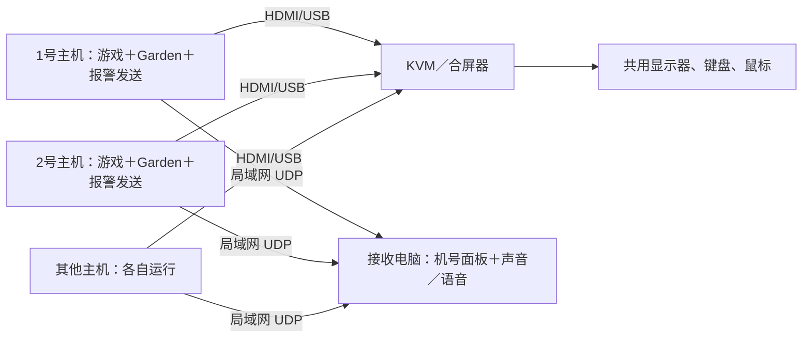

# Garden 多机报警方案（设计稿，尚未实现）

目标：每台 Windows 主机各自运行现有 Garden，只把状态和测谎报警发给一台接收电脑。接收电脑明确显示和播报机号，操作者通过 KVM 或 UU 切到对应主机，手动处理测谎。第一版不自动操作测谎，不通过网络发送游戏操作或恢复指令。

## 保留单机版

- 单机基线：`306b9e84090249eac06b01f7339bdf0cd18e5112`，标签 `singlehost-garden-20261027`。
- 多机开发分支：`multihost-garden`。本设计阶段不修改 `lionbot/` 或现有配置、模板。
- 单机仍用 `python.exe -m lionbot.garden --run`；新多机版本另设 `lionfleet` 入口，部署到另一个文件夹，例如 `mxd-multi`，不要覆盖 `mxd-single`。
- Git 不保存本机 `config.garden.local.json`、`calibration/`、`.venv/`。云端有用户此前上传的一份配置，但没有游戏电脑上的完整模板和地形参考；完整本机备份仍须在该电脑上复制整个旧目录。

在现有项目根目录用 PowerShell 创建相邻备份，备份目录不要放在源目录里面：

```powershell
$mxdSource = (Get-Location).Path
$mxdBackup = Join-Path (Split-Path $mxdSource -Parent) ("mxd-single-backup-" + (Get-Date -Format "yyyyMMdd-HHmmss"))
Copy-Item -LiteralPath $mxdSource -Destination $mxdBackup -Recurse
```

这一步在实际游戏电脑上执行；云端无法代为复制那台电脑的文件。后续同步程序时保留每台机器自己的校准目录，不把一台机器的配置强行覆盖其他机器。

## 推荐连接方式



接收端优先用平时操控 UU 的电脑或独立笔记本，同一路由器／交换机即可，不要求接到 KVM，不需要采集卡。已有音箱、笔记本扬声器或耳机可以播放报警。若接收端同时也是挂机主机，其报警界面必须不抢游戏焦点，部署和验收会更复杂，第一版优先分开。

KVM 管画面和人工输入，局域网管报警，二者独立。主机 HDMI 音频通常随所选端口切换，所以不能只依赖各主机不同音调。接收端使用自己的固定播放设备，不依赖 KVM 当前 HDMI 音源。

## 先验收硬件

商品截图显示设备带合屏／同步功能，但不能据此确认每个输入端的 EDID 保持能力。部署前向商家核实并实际测试：

1. **切走后仍有显示器连接。** 每个输入口是否保持 EDID／热插拔状态？未选中的主机能否保持桌面分辨率、正常渲染和截图？若切换导致黑屏、尺寸改变或游戏停止渲染，要先解决显示保持；可能需要支持每路 EDID 保持的 KVM 或兼容接线的显示模拟器。
2. **关闭键鼠同步／广播。** 一次只控制指定机号；处理一台的测谎时，不应把鼠标和按键同步给其他主机。
3. **合屏缩放不用于校准。** HDMI 合屏上的小窗口是硬件缩放画面。程序始终在各主机本地截取游戏客户区，不识别合屏后的总画面。每台固定桌面缩放和游戏窗口尺寸，优先保留当前 `1366×768` 客户区。
4. **保持 Windows 会话可用。** 游戏在各自主机保持前台、不最小化，避免睡眠或锁屏。用 UU 操作后检查游戏恢复前台；切换物理 KVM 本身不等于切换 Windows 前台，但必须实测。不要用 RDP 会话代替已经验证的 UU／本机控制方案。

先让一台主机跑观察模式并切走十分钟，再切回检查截图、窗口尺寸、黄点和监控状态；这一项不通过，先不要扩展机器数量。

## 两端分别负责什么

| 组件 | 职责 |
| --- | --- |
| 每台主机 | 独立截图、识别、D 攻击、巡逻、Alt、五秒原地恢复；发现测谎先停键并锁定暂停，再异步发送报警；保留原始本地 Beep |
| 接收电脑 | 监听 UDP、维护在线状态、显示机号和 KVM 口号；先提示音，再语音“2号机出现测谎，请处理”；记录时间和状态 |
| 操作者 | 按机号切换 KVM 或打开相应 UU，手动完成测谎，按该机现有 F8 流程恢复 |

接收端“静音”只停止接收端播报；网络 ACK 只代表收到了消息。两者都不恢复游戏。标题消失也不自行恢复，仍沿用本机人工确认及有效画面检查。

机号与物理端口贴同样的标签，例如 `M01／1号机／KVM 1`。IP 用于通信，机号才用于识别身份；不要把 DHCP 地址当作永久机号。

## UDP 必须补齐的可靠性

不采用“只发一个包”的方案。约定接收端 UDP 端口 `27676`，地址固定为接收电脑在局域网内的地址；在路由器中为其保留 DHCP 地址。示例 `192.168.1.10` 必须替换成实际地址。接收端 Windows 防火墙只需允许这个局域网入站端口，不配置公网端口映射。

| 机制 | 第一版规则 |
| --- | --- |
| 即时报警 | 主机停键后立即入发送队列；网络线程不阻塞截图、停键或声音线程 |
| 收件确认 | 接收端处理后回复 ACK，包含相同机号、启动标识和事件号；它只是收件回执 |
| 丢包重发 | 未收 ACK 时按 0.5／1／2 秒间隔重试，之后每 2 秒重发当前事件；收到 ACK 不代表人工已处理 |
| 心跳 | 每 2 秒报告当前状态，接收端回复确认；已报警状态在心跳中持续携带，接收端重启后也能恢复待办 |
| 去重和顺序 | 每进程启动生成 `boot_id`；消息有递增 `seq`，每次报警有稳定 `alarm_id`。重复包不重复创建待办，旧序号或不匹配的解除事件不能清掉新报警 |
| 多机并发 | 面板立即显示全部待处理机号；新报警优先进入声音队列，已有报警轮流播报，避免只播一台 |
| 离线检测 | 超过 10 秒无新心跳显示失联；有未处理报警的主机失联时，报警仍保留 |
| 接收端不可用 | 多机模式启动前先验证握手；运行中超过 15 秒无有效回执时，该机停键并本地提示“接收端失联”。网络恢复后通过本机 F8 人工恢复，不改动单机模式 |
| 恢复通知 | 只有本机人工恢复成功，才发送对应 `alarm_id` 的恢复事件；进程重启不等于旧测谎已解决 |

心跳是独立线程，但还要携带主循环和测谎扫描的更新时间：不能因为发送线程仍活着，就把截图线程卡死显示为“正常”。面板至少区分运行、人工暂停、测谎待处理、截图／程序故障、失焦、失联。进程整体崩溃由心跳超时发现。

每个包控制在约 1KB 以内，只发机号、状态、事件号和短原因，不用 UDP 发截图。诊断截图继续保存在报警主机，按机号通过 UU 查看。接收端只接受登记机号和约定格式的状态消息，不执行收到的文字或命令。

## 声音和面板

- 推荐“通用警报音＋明确机号语音”，不同音调只作为补充。先用接收电脑自身扬声器确认可听，再做跨机测试，不依赖 UU 传音。
- Windows 语音使用系统已有的中文语音引擎；部署时逐台测试机号播报。若该 Windows 没有可用的中文语音，可给每台指定本地 WAV。语音失败不能影响面板更新和普通提示音。
- 面板显示：机号、KVM 口号、状态、最后心跳、报警时间、待处理时长。允许逐条静音；新报警不能被上一次全局静音永久屏蔽。
- 截图错误与真正检出测谎分别播报，例如“3号机截图异常”，避免用户切过去后找不到测谎框。
- 日志记录收到、重复、超时、人工恢复等状态；声音工作线程和网络线程分离，多台同时报警时不相互阻塞。

## 配置与文件划分

现有 `config.garden.local.json` 严格校验字段，**不要把机号和网络字段直接加进去**。保留其全部原参数，多机通讯单独配置。

拟新增文件（尚未实现，不是当前可执行命令）：

```text
lionfleet/
  garden.py        多机入口：复用现有 Garden 核心，接入状态和报警事件
  transport.py     UDP、ACK、重试、心跳；不发送游戏操作
  receiver.py      接收、状态面板、声音队列、日志
  protocol.py      消息格式、校验、去重
config.machine.example.json
config.receiver.example.json
```

每台主机的独立配置示例 `config.machine.local.json`：

```json
{
  "machine_id": "M01",
  "machine_name": "1号机",
  "kvm_port": 1,
  "receiver_ip": "192.168.1.10",
  "receiver_port": 27676,
  "heartbeat_seconds": 2,
  "receiver_timeout_seconds": 15
}
```

其他主机只改机号、名称和端口；接收端登记相同映射。接收端不需要 OpenCV、MSS 或游戏客户端，可以使用标准 Python 的 socket、threading、queue、tkinter、winsound 和系统语音；挂机主机沿用原依赖，第一版不加消息中间件或数据库。

多机入口拟使用：

```powershell
# 以下命令为实现目标，当前代码中尚不存在
python.exe -m lionfleet.receiver --config config.receiver.local.json
python.exe -m lionfleet.garden --config config.garden.local.json --machine-config config.machine.local.json --run
```

若同一套 Garden 核心需在新版本进一步修改，先在多机目录验证，不覆盖保留的单机目录。当前上传配置的 D 次数为 1、Alt 为 190 秒，继续原样使用。

## 分阶段落地和验收

| 阶段 | 交付 | 验收通过条件 |
| --- | --- | --- |
| 1：保留版本＋硬件检查 | 单机标签、本机完整副本、固定显示设置、机号贴纸 | 切走主机后继续截图十分钟，切回后尺寸和画面有效 |
| 2：两台机器通知 | 接收端、测试发送命令、机号播报、ACK／重试／心跳 | 连续测试 M01／M02，不看终端也能从声音和面板确定机号；接收端关闭和网络中断可检出 |
| 3：Garden 接入 | 独立多机入口，本地先停键、报警上报、人工恢复 | 用检测器样图离线回放／测试事件验收，不主动触发游戏测谎；在游戏正常运行时确认新入口不改变 D／F／Alt 和巡逻 |
| 4：小规模长跑 | 先两台运行，再逐步接满 KVM | 同时报警、重复和乱序包、接收端重启、发送进程异常、失焦、静音后再来新报警均正确；实际使用中遇到测谎时确认本地停键和远端通知 |

网络测试和模拟报警不等于验证了真实游戏检测，已可工作的本机检测器继续保留。第一轮先验收“正确机号、可听见、本地已停键、能人工接手”，之后再考虑自动启动、更多地图或其他通知渠道。
