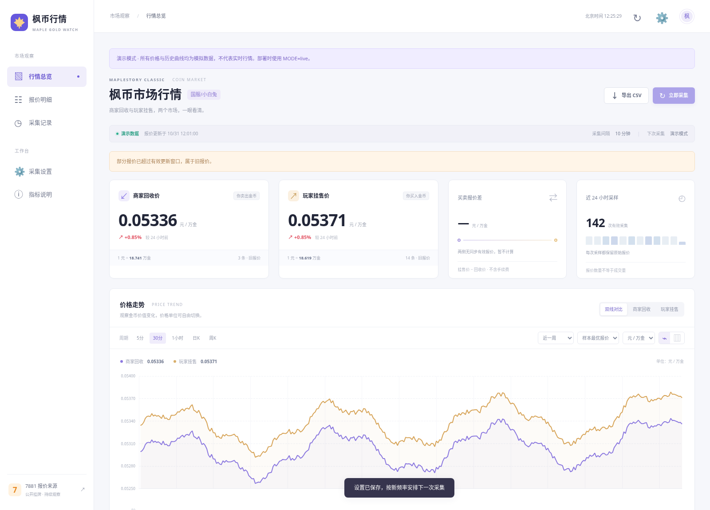

# 枫币行情 · 宝塔原生 Python 版

面向 **Ubuntu 24.04、Python 3.12、已有 MySQL、2 核 2GB** 的独立项目。入口 `run.py`，使用一个 Uvicorn 进程运行网页和后台定时采集，无需 Docker、Compose、Node 项目或重新安装 MySQL。

[下载独立包](https://github.com/btc2060/mxd/raw/refs/heads/gold-price-monitor-python-baota/downloads/maple-goldwatch-python.zip)。上传到 `/www/apps/` 并解压，得到 `/www/apps/maple-goldwatch-python/`。原始 Python 版和 Node 版保留在各自分支中。



来源：<https://search.7881.com/G6344-100001-G6344P002-G6344P002005-0.html?pageNum=1>

**实际验证边界：** 核心测试、真实 Chromium 的本地页面解析和原生 Python＋MySQL 检查可以在开发环境完成。开发环境网络白名单不含 7881，因此没有在线核验源站当前页面，不能承诺切换语言后就能抓取。服务器上的 `doctor --source` 用于确定真实访问、浏览器运行和页面解析结果；若无报价，可保存页面再适配。换语言不会消除源站限制或浏览器权限问题。

本次已通过 27 项测试，覆盖无人访问时自动入库、双市场解析、报价换算、K 线、认证、失败保留和只读闲置调度；也通过原生 Python＋MySQL 8.4、重启持久化、桌面／手机网页与真实 Chromium 的离线验证。本机检查时网页进程约 81MB RSS，这不包含 MySQL、Chromium 或服务器其他项目，不代表整机峰值。

## 先保留现有文件

在宝塔备份目前的 `goldwatch` MySQL 数据库。保留 `/www/apps/maple-goldwatch-node` 目录及 `.env`。

在宝塔停止原 Node 项目的**应用进程**，取消其自动重启；保留已经正常工作的 Nginx 站点和反向代理。新的 Python 应用仍监听 `127.0.0.1:8080`，现有 `listen 80;` 和 `proxy_pass http://127.0.0.1:8080;` 可以继续使用。不要把 Nginx 的监听端口改为 8080。

只运行一份应用。Python 项目先不重复绑定同一个 IP／域名，以免生成冲突的 Nginx 站点。若计划另建站点，应先解除旧站点的域名绑定，再创建新的 80 端口代理。

## 1. 安装到独立 Python 环境

Ubuntu 24.04 自带 Python 3.12，也可使用宝塔“Python 环境管理”中安装的 3.12。先在 root 终端检查：

```bash
python3 --version
```

上传并解压独立包后：

```bash
cd /www/apps/maple-goldwatch-python
python3 -m venv .venv
.venv/bin/python -m pip install -r requirements.lock.txt
.venv/bin/python tools/setup.py
```

如果缺少 `venv`：

```bash
apt-get update
apt-get install -y python3-venv
```

再执行创建 `.venv` 和安装依赖的命令。`requirements.lock.txt` 是本次验证的固定版本；安装在项目内，不改系统 Python 包。Python 3.11／3.12 可运行，部署建议统一使用 3.12。

## 2. 填写现有数据库配置

打开新项目的 `.env`，把 Node 版中已经验证可用的 MySQL 主机、端口、库名、用户名、实际密码填入对应字段：

```dotenv
HOST=127.0.0.1
PORT=8080
MYSQL_HOST=127.0.0.1
MYSQL_PORT=3306
MYSQL_DATABASE=goldwatch
MYSQL_USER=goldwatch
MYSQL_PASSWORD="这里填写实际数据库密码"
ADMIN_TOKEN=这里保留setup生成的随机口令
MODE=live
COLLECTOR_ENABLED=true
BROWSER_ENABLED=true
PLAYWRIGHT_BROWSERS_PATH=.browsers
CHROMIUM_EXECUTABLE_PATH=
```

不要求 `DATABASE_URL`，程序会安全编码密码中的特殊字符。也可复用原有 `mysql://...`／`mysql+pymysql://...` 连接地址，但有 `DATABASE_URL` 时会优先使用它。`setup.py` 不会创建或修改 MySQL 用户密码，不覆盖已有 `.env`。

使用专用数据库用户，不用 root。初始化沿用现有的 `preferences`、`collector_lease`、`crawl_runs`、`quotes`、`snapshots` 五张表，`create_all` 不删表或清空历史。旧设置及频率也会保留。

设置项目权限，仅对这个新目录执行：

```bash
chown -R www:www /www/apps/maple-goldwatch-python
chmod 600 /www/apps/maple-goldwatch-python/.env
```

检查数据库：

```bash
cd /www/apps/maple-goldwatch-python
.venv/bin/python -m goldwatch.cli check-db
```

## 3. 浏览器按需配置，可复用已下载文件

采集优先使用 HTTP；公开 HTML 已有两类报价时，不会启动浏览器。需要动态渲染时，最多启动一个 Chromium，任务完成后关闭。`BROWSER_ENABLED=false` 可禁止浏览器，但 HTML 没有报价时会明确失败，不能靠这个设置获得动态数据。

如果之前 Node 版已经把 Chromium 下载到 `/www/apps/maple-goldwatch-node/.browsers`，优先复用：在新项目 `.env` 中改为绝对路径：

```dotenv
PLAYWRIGHT_BROWSERS_PATH=/www/apps/maple-goldwatch-node/.browsers
```

然后用与正式项目相同的 `www` 用户进行本地检查：

```bash
cd /www/apps/maple-goldwatch-python
runuser -u www -- /www/apps/maple-goldwatch-python/.venv/bin/python -m goldwatch.cli doctor
```

会打印 Python／Playwright 版本、浏览器路径、UID 和实际失败原因，不打印数据库密码。`本地浏览器测试：PASS` 说明当前用户能够启动浏览器，不代表源站已抓取成功。

**仅在浏览器不存在或需要重新安装时**，将 `.env` 的 `PLAYWRIGHT_BROWSERS_PATH` 改回 `.browsers`，执行：

```bash
cd /www/apps/maple-goldwatch-python
PLAYWRIGHT_BROWSERS_PATH=/www/apps/maple-goldwatch-python/.browsers .venv/bin/python -m playwright install --with-deps --no-shell chromium
chown -R www:www /www/apps/maple-goldwatch-python/.browsers
```

安装系统依赖需要 root；始终使用本项目 `.venv/bin/python -m playwright`，无需 `npx`。不要把浏览器装到 root 私有缓存后交给 www 运行。若有现成 Chrome，也可用 `CHROMIUM_EXECUTABLE_PATH=/实际路径/chrome` 显式指定。

## 4. 验证真实源站，不写数据库

```bash
cd /www/apps/maple-goldwatch-python
runuser -u www -- /www/apps/maple-goldwatch-python/.venv/bin/python -m goldwatch.cli doctor --source --save-page
```

先检查本地浏览器，再读取 robots、第一页公开 HTML，并按需渲染。输出商家／玩家各自数量及具体失败阶段。该命令不连接数据库、不改变设置、不保存报价；只在 `artifacts/diagnostic-日期时间/` 保存诊断用 HTML 和浏览器画面。该目录不通过网页提供访问。

只有两类真实报价均获取到、与原站对应，才算来源验收通过。若本地浏览器 PASS 但这里失败，按 DNS、证书、超时、验证页面或解析结果处理；不要反复重装浏览器。出现人机验证、403／429 或 robots 禁止访问时不会绕过。

只检查 HTTP、不启动浏览器：

```bash
.venv/bin/python -m goldwatch.cli doctor --source --http-only --save-page
```

诊断默认使用第一页和自动识别，不读取数据库里保存的自定义选择器。诊断 HTML 可用于检查 DOM 与调整两个市场各自的卡片选择器。

## 5. 在宝塔添加 Python 项目

宝塔“网站 → Python 项目 → 添加项目”，按面板支持的自定义启动方式配置：

| 项目项 | 设置 |
| --- | --- |
| 项目路径／工作目录 | `/www/apps/maple-goldwatch-python` |
| Python | 3.12；使用项目 `.venv` |
| 入口文件 | `run.py` |
| 自定义启动命令 | `/www/apps/maple-goldwatch-python/.venv/bin/python /www/apps/maple-goldwatch-python/run.py` |
| 运行用户 | `www` |
| 项目端口 | `8080` |
| 进程数 | `1` |
| 重启／开机启动 | 开启 |

`run.py` 自己启动单进程 Uvicorn；不要再用多个 Gunicorn worker 包裹它，也不要选择只支持 WSGI 的启动方式，FastAPI 使用 ASGI。不同宝塔版本的字段可能不同，以“自定义命令／脚本入口”方式运行即可。

如果面板无法指定项目的 `.venv` 或不支持自定义命令，可使用下一节的原生 systemd 方式。两种守护方式只选一种。

启动后检查：

```bash
curl --max-time 5 http://127.0.0.1:8080/api/health
```

应包含 `"runtime":"python"`。继续访问原有 IP／域名；原代理指向 8080，无需更换端口或再开放 8080 到公网。

采集设置中输入新 `.env` 的管理员口令，确认“启用定时采集”勾选、自动方式、间隔 600 秒、第一页。手动采集后核对两类报价和时间。仅网页能打开或 MySQL 通过，不代表抓取来源成功。

## 可选：原生 systemd 守护

此方式不依赖面板应用管理器，也没有 Docker。先确保宝塔没有再启动同一份 Python 应用：

```bash
cp /www/apps/maple-goldwatch-python/deploy/goldwatch.service /etc/systemd/system/goldwatch.service
systemctl daemon-reload
systemctl enable --now goldwatch
systemctl status goldwatch --no-pager
```

查看日志：`journalctl -u goldwatch -n 80 --no-pager`。更新后重启：`systemctl restart goldwatch`。应用停止：`systemctl stop goldwatch`。

## 2GB 主机的运行安排

- 一个网页／后台进程、一个采集任务、浏览器最多一个，采集后关闭；请求数据库池为 2，最多额外 1 个连接。
- 默认每 10 分钟、第一页，不做全站并发扫描；网页查看人数不改变抓取频率。
- 没有访客也会定时抓取和存储。调度闲置时只读检查，不反复写采集锁。
- 先停止旧 Node 采集服务，避免两套程序和浏览器竞争内存。保留文件不占运行内存。
- 实际峰值还取决于网页、MySQL 和同机其他项目。若接近内存上限，减少同机其他负载并查看浏览器失败原因；换成 Python 不等于浏览器不再消耗资源。

## 数据与日常使用

商家回收和玩家挂售分开保存；保留 `1元=X万金` 和 `1万金=Y元`。商家取样本最高收购单价，玩家取样本最低挂售单价。它们是挂牌报价，不是成交价，前几页也不等于全站。

保留双市场走势、单市场 K 线、5 分钟／30 分钟／1 小时／日／周周期、时间范围、CSV、报价明细、定时设置和采集日志。10 分钟抓取不会补造每 5 分钟价格，没有历史的时段留空。失败保留上一笔有效价格及原时间，不写零价。

管理员可从网页触发采集，也可在项目目录执行 `.venv/bin/python -m goldwatch.cli collect`。后台和手动采集共用数据库租约，避免并发；刚切换程序且旧任务被强行结束时，旧租约最多约 5 分钟后过期。

MySQL 使用宝塔已有备份计划。升级先备份，保留 `.env` 和浏览器目录，不删库。管理员口令和数据库密码不要公开；Web 只提供 `static/` 和 API。

## 开发验证

```bash
.venv/bin/python -m pip install -r requirements-dev.txt
.venv/bin/python -m pytest -q
CHROMIUM_EXECUTABLE_PATH=/usr/bin/chromium .venv/bin/python tools/check_browser.py
```

浏览器检查把所有网页请求拦截为本地 HTML 或模拟 DNS 失败，不访问 7881／MySQL。覆盖双市场解析、实际 Chromium、空白 iframe 与错误详情。测试中的模拟数据不作为在线源站已验证的证明。
