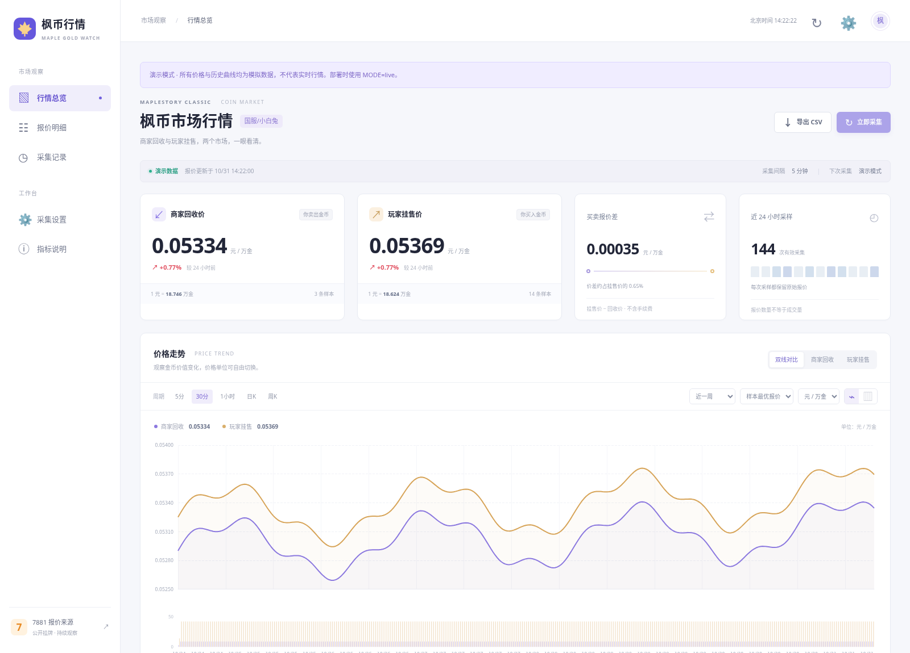

# 枫币行情 · Node.js 版

独立的 **Node.js＋HTML/ECharts＋MySQL** 项目，按宝塔原生 Node 项目部署。适用于你现在的 **Ubuntu 24.04.2＋Node v24.13.1**，复用宝塔已经安装的 MySQL。运行应用无需 Python、Docker、Compose，也无需再次安装 MySQL。

[下载独立部署包](https://github.com/btc2060/mxd/raw/refs/heads/gold-price-monitor-node/downloads/maple-goldwatch-node.zip)。解压后使用 `maple-goldwatch-node` 目录。原来的 Python 版保留在 `gold-price-monitor` 分支，未修改。



监控来源：<https://search.7881.com/G6344-100001-G6344P002-G6344P002005-0.html?pageNum=1>

**当前验证范围：** 已通过本机 Node 24、临时 MySQL 8.4、真实 Chromium 的接口及网页测试。但开发环境的出站白名单不含 7881，未完成源站实时 HTML 核验。解析测试使用用户截图对应的 2 条商家和 5 条玩家报价构建的测试页。你的服务器首次部署后，需要确认两种价格均采集成功、明细与原站对应；动态结构或选择器仍可能需要适配。

## 宝塔部署流程

### 1. 停止旧程序，准备目录

如果终端还在运行旧的 `docker compose ... --build`，按 `Ctrl+C` 停止。如果旧 Python 服务已经启动，在宝塔 Docker 中只停止旧项目的网页容器；不要删除已有数据库或数据卷。新旧应用不要同时占用 8080，也不要同时向同一库采集。

在宝塔“文件”中新建目录 `/www/apps`，上传并解压独立部署包。最终应为：

```text
/www/apps/maple-goldwatch-node/
  package.json
  package-lock.json
  .env.example
  scripts/
  src/
  static/
```

使用 `git clone` 时，对应的是仓库的 `goldwatch-node` 子目录，后续命令也应在该子目录运行。以下示例统一采用上面的独立包路径。

### 2. 使用已有 MySQL

在宝塔“数据库 → MySQL”确认服务正在运行。Docker 商店里另一个 MySQL 显示“安装”不表示你必须安装它。

在已有 MySQL 中新增专用数据库，例如 `goldwatch`，字符集 `utf8mb4`；使用宝塔创建的对应用户和密码。权限只需覆盖该库的建表、索引、读写，不要使用 root 账号运行网页。

同机原生 MySQL 一般使用 `127.0.0.1:3306`。如果原有 MySQL 是容器，填写它实际映射到本机的地址和端口，不能直接使用旧 Compose 内部的主机名 `mysql`。无需把 3306 开放到公网。

如果原 Python 版已存有行情，先用宝塔备份数据库，再停掉旧采集器。Node 版沿用原版的五张表，可连接原库；初始化使用 `CREATE TABLE IF NOT EXISTS`，不会删表或覆盖历史。旧库字符集、授权和实际表结构须正常。

### 3. 切换到宝塔 Node 24，安装依赖

在宝塔的 Node 版本管理中选择 `v24.13.1`，打开终端检查：

```bash
node -v
npm -v
cd /www/apps/maple-goldwatch-node
npm ci --omit=dev
npm run setup
```

如果终端显示 `node: command not found` 或版本不同，使用宝塔 Node 管理器的“设置命令行版本”功能，或使用该版本提供的完整可执行路径。

`npm run setup` 生成 `.env`，含随机管理员口令和完整 `MYSQL_*` 字段；存在时不会覆盖。安装依赖不会自动下载 Chromium。

### 4. 编辑 .env，填写实际数据库密码

在宝塔文件编辑器打开项目根目录 `.env`，例如：

```dotenv
HOST=127.0.0.1
PORT=8080
MYSQL_HOST=127.0.0.1
MYSQL_PORT=3306
MYSQL_DATABASE=goldwatch
MYSQL_USER=goldwatch
MYSQL_PASSWORD="这里替换成宝塔数据库的实际密码"
ADMIN_TOKEN=这里保留setup生成的随机口令
MODE=live
COLLECTOR_ENABLED=true
CHROMIUM_PATH=
PLAYWRIGHT_BROWSERS_PATH=.browsers
```

`MYSQL_PASSWORD` 必须填写已有数据库用户的实际密码，`setup` 不会创建或修改数据库密码。单独字段可以直接填写含 `@`、`#` 等符号的密码，无需 URL 编码；含 `#`、空格等字符请保留引号。

**此版本不要求 `DATABASE_URL`。** 如需兼容原有配置，也支持 `mysql://...` 或 `mysql+pymysql://...`；设置后会优先使用 URL，忽略独立 `MYSQL_*` 字段。建议新部署只使用独立字段，避免两套配置冲突。

应用始终加载项目目录中的 `.env`，无需宝塔另外生成配置文件。文件不要放入静态网站目录，也不要发送数据库密码或管理员口令给别人。

### 5. 检查数据库并前台试运行

```bash
cd /www/apps/maple-goldwatch-node
npm run db:check
npm start
```

成功时出现“MySQL 连接和应用表检查通过”“Node 服务已启动，监听 127.0.0.1:8080”。另开一个宝塔终端测试：

```bash
curl http://127.0.0.1:8080/api/health
```

预期返回：

```json
{"ok":true,"mode":"live","runtime":"node"}
```

首次启动会自动采集，默认每 10 分钟一次。抓取失败不影响打开看板，具体错误在“采集记录”中显示；有旧报价时保留旧价格和原时间。测试完成后，在前台终端按 `Ctrl+C`，再配置下一步的常驻运行，避免端口重复。

### 6. 在宝塔添加 Node 项目并守护运行

宝塔不同版本入口可能叫“网站 → Node 项目”或“Node 项目管理”，填写：

| 项目项 | 值 |
| --- | --- |
| 名称 | maple-goldwatch-node |
| 项目根目录 | `/www/apps/maple-goldwatch-node` |
| Node 版本 | `v24.13.1` |
| 启动方式 | package.json 中的 `start`，即 `npm start` |
| 若面板只支持入口文件 | `src/server.js` |
| 端口 | `8080`，与 `.env` 一致 |
| 运行用户 | `www` |
| 进程数量 | **1**，fork 模式 |
| 自动重启／开机启动 | 开启 |

项目设置完成前，在终端设置新项目目录归属，确保 `www` 能读取 `.env`：

```bash
chown -R www:www /www/apps/maple-goldwatch-node
chmod 600 /www/apps/maple-goldwatch-node/.env
```

此命令只对新建的项目目录使用。不要在 `/www` 或其他网站根目录上执行递归改权限。使用宝塔的进程管理后，无需再手动另开一套 PM2 或 `npm start`。

### 7. 配置域名和反向代理

域名解析到服务器公网 IP。在宝塔添加该域名的站点，反向代理目标设置为：

```text
http://127.0.0.1:8080
```

代理整个 `/`，不要只代理 `/api/`。如果 Node 项目自带“域名映射”可直接使用，不要再创建重复的同名站点。申请 SSL 证书并开启 HTTPS，外网只需放行 80、443；默认无需开放应用的 8080。

浏览器访问域名后，进入“采集设置”，输入 `.env` 中的 `ADMIN_TOKEN`。只读看板无需口令，修改频率、立即采集、HTML 导入需要口令。

只有服务器 IP、暂时没有域名时，可短期将 `.env` 中 `HOST` 改成 `0.0.0.0`，重启项目，并在宝塔防火墙、阿里云安全组放行 8080，然后访问 `http://服务器IP:8080`。公网长期使用建议完成 HTTPS 反向代理，再改回 `127.0.0.1`。

### 8. 只有动态报价缺失时，安装 Chromium

采集优先使用公开 HTML，解析到两种报价就无需浏览器。没有找到动态区域时，日志会提示是否缺少 Chromium；这部分依赖取决于源站实际页面。

先在项目目录安装浏览器及 Ubuntu 系统依赖：

```bash
cd /www/apps/maple-goldwatch-node
PLAYWRIGHT_BROWSERS_PATH=/www/apps/maple-goldwatch-node/.browsers npx playwright-core install --with-deps chromium
chown -R www:www /www/apps/maple-goldwatch-node/.browsers
```

安装系统依赖需要 root 权限，可使用宝塔的 root 终端。浏览器存放在项目的 `.browsers` 目录，避免安装到 root 私有缓存后 `www` 无法读取。保持 `.env` 中 `PLAYWRIGHT_BROWSERS_PATH=.browsers`，`CHROMIUM_PATH` 留空，程序自动寻找浏览器，然后在面板重启项目。

Ubuntu 24 的 `apt install chromium-browser` 可能引入 Snap，不作为此部署流程。若系统已有可执行的 Chrome/Chromium，可直接在 `.env` 设置 `CHROMIUM_PATH=/实际路径/chrome`。`CHROMIUM_PATH` 显式指定时优先使用它。

如果下载浏览器仍受网络影响，可以先运行网页和 HTML 采集；缺少浏览器时不会伪造缺失区域。不要关闭证书校验或把随机第三方镜像当成必需配置。

### 9. 首次验收

在网页“采集设置”验证口令，点“立即采集”。检查：

1. 记录为成功，商家和玩家数量均大于 0，明细来源与 7881 页面对应。
2. 商家回收、玩家挂售分别显示，两种换算互为倒数。
3. 页面有真实更新时间，等待下一轮后历史继续积累。
4. 在面板重启 Node，报价及设置仍在。

也可在终端执行一次采集并看结果（数据库锁会防止与后台重复）：

```bash
cd /www/apps/maple-goldwatch-node
npm run collect
```

“数据库连接通过”仅证明 MySQL 可用，不能代表 7881 实时采集已成功。若只有一个区域，界面标记为部分成功，另一侧不会复制或补造。

## 行情功能和价格含义

- 商家回收：你出售金币，取已采样报价中最高的 `元/万金`，等价于最低的 `万金/元`。
- 玩家挂售：你购买金币，取已采样报价中最低的 `元/万金`，等价于最高的 `万金/元`。
- 默认每 600 秒抓取第一页，可改为 60～86400 秒、前 1～3 页；推荐 5～10 分钟。网页每 30 秒刷新显示，不会因此加快抓取。
- 双市场折线、单市场 K 线，支持 5 分钟、30 分钟、1 小时、日线、周线；查看 24 小时、7 天、30 天、90 天，支持样本最优／中位数、两种价格单位。
- 24 小时变化、价格区域明细、价差、历史 CSV、采集日志、定时暂停和手动采集。
- 所有金额使用 Decimal 和 MySQL DECIMAL 保存；展示和图表阶段才转换为数值。周线按北京时间周一开始。
- 报价不是成交价，前几页最优不代表全站最优。图下方柱形表示采样报价条数，不是成交量。
- 每 10 分钟采集不会产生真实的每 5 分钟数据；没有采样的时间留空，不补值。历史从启用后累计。
- 过期报价保留原时间并提示，只有同一次采集且未过期的两种价格才计算价差。
- 数据库租约防止多进程重复抓取，超时、失败退避、进程重启后遗留任务恢复均有处理。

## 来源适配和限制

采集器使用“立即出售／立即购买”及价格单位识别卡片，支持 HTML、Chromium 和自动模式。动态浏览器只做正常页面加载，不绕过登录、验证码、403／429 或 robots 限制。

若页面改版，可在设置中分别指定商家、玩家的 CSS 选择器，**每个匹配元素应为一张报价卡片**，不要选整列或整个网页。清空选择器恢复自动识别。

可在自己的浏览器正常打开公开报价页，保存 HTML，然后通过设置中的“页面适配与手动导入”上传。导入记录会标注“手动导入”，按导入时刻记录，不伪造过去数据。仅保存页面外壳可能不包含动态区域；验证页也不能作为报价导入。

## 常见问题

| 现象 | 处理 |
| --- | --- |
| `ECONNREFUSED` | 检查 MySQL 是否运行、地址和端口是否正确；Node 原生进程连接本机数据库通常用 127.0.0.1 |
| `Access denied` | 核对 `.env` 的实际用户和密码、该用户授权范围；不要把生成的管理员口令当数据库密码 |
| `Unknown database` | 先在宝塔创建 `.env` 指定的数据库 |
| `EADDRINUSE` | 停掉前台试运行或旧网页服务，或修改应用端口和代理目标 |
| 站点 502 | 先检查 Node 日志、`/api/health`，再检查宝塔代理端口 |
| `.env` 不可读 | 确认运行用户对项目有读取权限；www 运行时 .env 应归 www 所有 |
| 没有价格但网页可开 | 查看采集日志；可能是来源网络限制、robots、动态区域缺失或 DOM 需要适配 |
| 缺少 Chromium／共享库 | 执行第 8 步，检查浏览器归属、CHROMIUM_PATH，重启 Node |
| 曲线断开或一开始空白 | 缺少历史的正常显示；不要用演示数据填充真实模式 |

## 备份、更新与演示

用宝塔“数据库 → 备份”定期备份整个 `goldwatch` 库，CSV 不能代替数据库备份。应用表为 `preferences`、`collector_lease`、`crawl_runs`、`quotes`、`snapshots`。

升级先备份数据库并停止 Node，保留 `.env` 和 `.browsers`，更新代码与锁文件，运行 `npm ci --omit=dev` 后重启。不要删除数据库。此初版不对原表做破坏性结构变更。

只看界面时可暂将 `.env` 改为 `MODE=demo` 并重启，仍需连接 MySQL。页面会显著标记模拟数据，不会采集真实来源；模拟历史与真实历史通过 `dataset` 字段隔离。恢复 `MODE=live` 并重启才是实际采集模式。

## 开发验证

```bash
npm ci
npm test
```

测试覆盖截图报价、两市场隔离、Decimal 倒数、卡片范围、链接、编码、参数验证、时间和 K 线、缺测留空、robots／429、分页去重、动态区域缺失。

可选 `npm run smoke` 使用本机 Docker 中的 `mysql:8.4` 做**开发测试**，并使用 `CHROMIUM_PATH` 或 `/usr/bin/chromium` 做浏览器检查；生产部署不需要 Docker。该脚本使用随机端口、随机凭据、临时库，跳过项目 `.env`，完成后删除测试容器和匿名卷，不接触已有数据库或 7881。覆盖 API、认证、设置、重启持久化、采集锁、失败保留、桌面和手机页面。

后端代码在 `src/`，前端在 `static/`。ECharts 已随代码本地提供，运行时不依赖图表 CDN，许可证保存在 `static/vendor/`。
